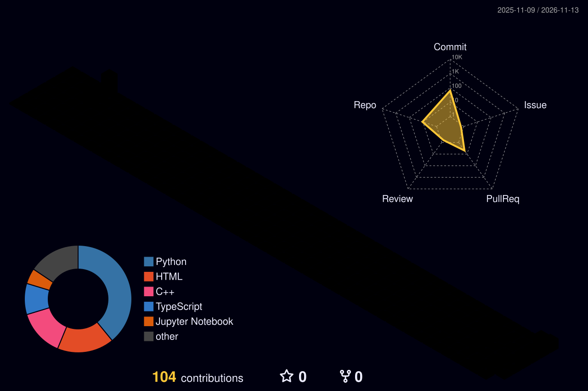

<h1 align="center">Hi, I'm Khanh 👋</h1>

  

  
  

🎓 CS student at the **University of South Florida** · 🧠 Into **AI** and how it's changing software · 🔨 Building AI projects · 🌱 Open to collaborating

  

  
  

<b>📊 More stats</b>

 

  
  

  

  

